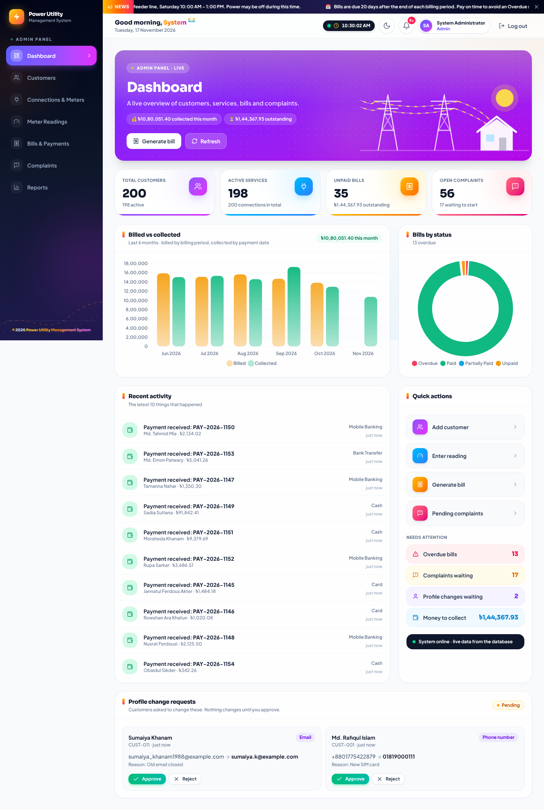
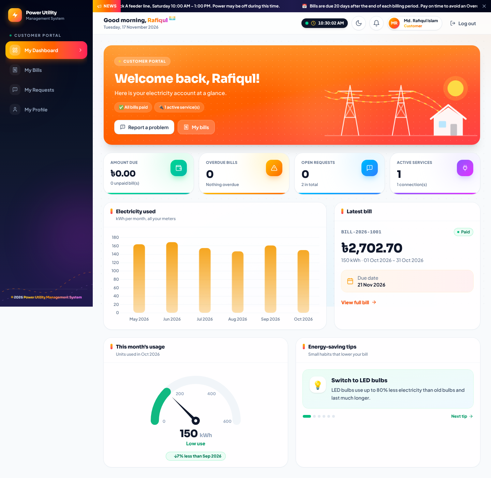
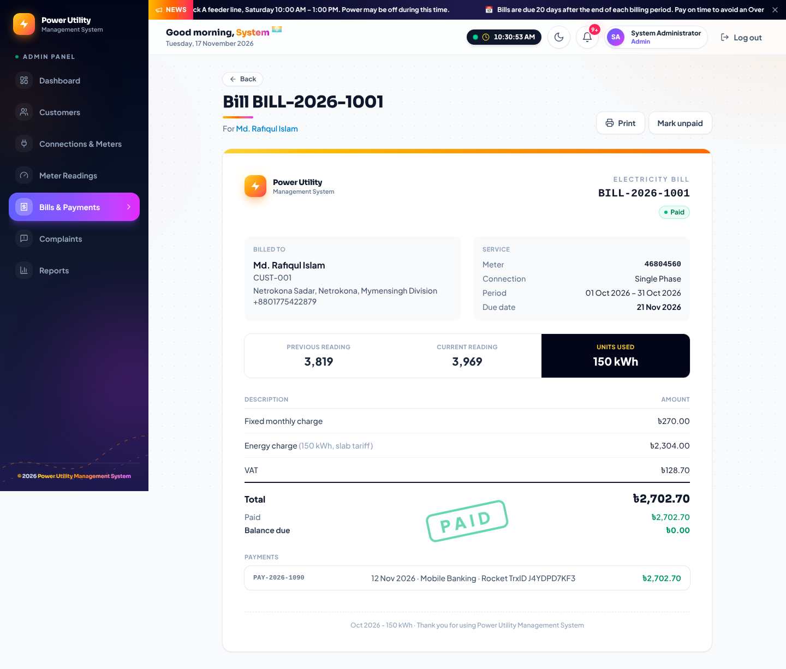
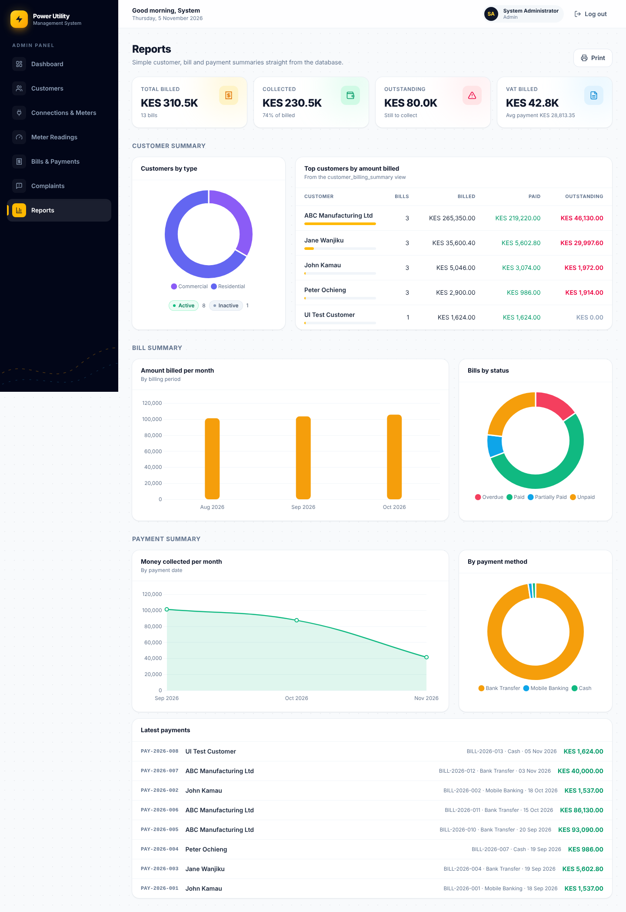

<div align="center">


# Sparkility

**Electricity billing and customer service, in one web app.**

An electricity company manages customers, connections, meters, readings, bills, payments and complaints.
Customers log in to see their own bills, pay, and send service requests.

[](https://github.com/sudipto57/power-utility-management-system/actions/workflows/checks.yml)


[](LICENSE)

[Live demo](https://power-utility-website.onrender.com) · [Documentation](docs/README.md) · [API reference](docs/03_api_reference.md) · [Database design](docs/02_database_design.md)

</div>

> Academic DBMS project. The database does the important work (foreign keys, CHECK constraints, triggers, views and PL/pgSQL functions); the API and the website show it off.
> The app was called *Power Utility Management System* until 27 Nov 2026, so some technical names (repository, database `power_utility_db`, npm packages) keep the old name on purpose.

---

## Contents

- [Screenshots](#screenshots)
- [Features](#features)
- [Tech stack](#tech-stack)
- [Architecture](#architecture)
- [Getting started](#getting-started)
- [Project structure](#project-structure)
- [Quality checks](#quality-checks)
- [Privacy and security](#privacy-and-security)
- [Deployment](#deployment)
- [Contributing](#contributing)
- [Team](#team)
- [License](#license)

## Screenshots

| Admin dashboard | Customer dashboard |
| --- | --- |
|  |  |
| **Bill details** | **Reports** |
|  |  |

More pages: [docs/05_user_guide.md](docs/05_user_guide.md) and [docs/screenshots/](docs/screenshots/). All people in the pictures are made up or blurred.

## Features

**Core (the 15 planned features)**

| | | |
| --- | --- | --- |
| Login with roles (Admin / Customer) | Admin and customer dashboards | Customer management and profiles |
| Electricity connections and meters | Meter reading entry | Bill generation from tariff slabs |
| Bill list with Paid / Unpaid status | Customer service requests | Complaint management |
| Search and filter on every list | Reports with charts | |

**Database-driven extras**

- Activity log written by a database trigger (who changed what, and when)
- Account statement with a running balance (SQL view)
- Usage alerts for unusual readings, automatic 5 % late fees and waivers
- Outage notices per area and meter replacement history

**Customer portal**

- Own meter readings and "this month so far", price-band warning, bill calculator with an appliance helper
- Pay now (saved as *Pending* until staff confirm), payment history and receipts
- Inbox with due reminders, replies on requests, profile pictures and profile change requests

**Accounts and security**

- Sign-up with email confirmation, forgot password, and a 4-digit email code at every customer login
- Passwords hashed with bcrypt, JWT login tokens, role checks on every admin route, rate limits on login and codes
- Support form on the first page, light and dark mode

## Tech stack

| Layer | Technology | Folder |
| --- | --- | --- |
| Website | React 19, Vite, Tailwind CSS v4, Chart.js, React Router | [`frontend/`](frontend/README.md) |
| API | Node.js, Express 5, plain SQL with `pg` (no ORM) | [`backend/`](backend/README.md) |
| Database | PostgreSQL on Supabase (also runs on local PostgreSQL), pgAdmin 4 | [`database/`](database/README.md) |
| API tests | Postman collection + environment | [`postman/`](postman/README.md) |
| Email | Brevo API (prints to the terminal when no key is set) | `backend/src/utils/email.js` |
| CI | GitHub Actions: privacy check, lint, build, syntax check | [`.github/workflows/`](.github/workflows/checks.yml) |

## Architecture

```
 Browser (React)  ── HTTPS + JWT ──▶  Express API  ── SQL (parameterised) ──▶  PostgreSQL
 localhost:5173   ◀───── JSON ──────  localhost:5000  ◀──────── rows ────────  (Supabase)
```

- The browser never talks to the database. Only the API does.
- Request flow: **route → requireAuth → requireRole → controller → SQL → `{ "data": ... }`**. Errors come back as `{ "message": "..." }` with a proper status code.
- Bill amounts are calculated **in the database** (`calculate_bill_amount()`), and balances come from the `bill_balance` view, never from JavaScript.

## Getting started

**You need:** Node.js 22.12 or newer (20.19+ also works), and a PostgreSQL database (a free Supabase project or a local PostgreSQL with pgAdmin 4).

**1. Database.** Run the files in [`database/`](database/README.md) in this order (pgAdmin → Query Tool, or Supabase → SQL Editor):

```
00_reset → 01_create_tables → 02_billing_tables → 03_functions_triggers_views → 04_sample_data
→ 07_supabase_security (Supabase only) → 09_account_security → 10_auto_save → 11_extra_features
→ 12_customer_inbox → 13_support_and_deletions → 14_profile_photos
```

**2. API** (terminal 1):

```bash
cd backend
cp .env.example .env      # Windows: copy .env.example .env, then fill in your database details
npm install               # also switches on the privacy-check git hooks
npm run db:test           # checks the database connection (23 tables)
npm run staff:password    # sets the staff password (staff logins start locked)
npm run dev               # http://localhost:5000/api/health
```

**3. Website** (terminal 2):

```bash
cd frontend
npm install
npm run dev               # http://localhost:5173
```

**4. Log in** with a demo account from the made-up sample data:

| Role | Username | Password |
| --- | --- | --- |
| Admin (Admin tab) | `PUMSadmin` | the staff password you set in step 2 |
| Customer (Customer tab) | `sumaiya.khanam` | `customer123`, then the 4-digit code (printed in the API terminal when no email key is set) |

The full beginner guide, with a troubleshooting table, is [docs/04_setup_guide.md](docs/04_setup_guide.md).

## Project structure

```
power-utility-management-system/
├── frontend/            React website: pages, components, charts, API calls
├── backend/             Express API: routes → controllers → SQL
├── database/            SQL files, run in number order
├── docs/                overview, database design, API reference, setup, user guide, testing, demo scripts
├── postman/             Postman collection and environment
├── tools/               privacy-check.mjs (blocks real people's data and secrets) + its lists
├── .githooks/           pre-commit and pre-push hooks that run the privacy check
├── .github/             CI workflow, issue templates, pull request template
├── Project Documents/   blueprint, roadmap, tech stack guide, viva questions, survey
├── CLAUDE.md            the team's coding, design and git rules (read before changing anything)
├── CONTRIBUTING.md      how to work on the project
├── SECURITY.md          how to report a security problem
└── CHANGELOG.md         what changed, by date
```

## Quality checks

Every push and pull request runs [`checks.yml`](.github/workflows/checks.yml):

| Check | What it does |
| --- | --- |
| Privacy check | No real emails, phone numbers, password hashes, keys or `.env` files in any new commit |
| Website lint and build | `oxlint` with zero warnings, then a production `vite build` |
| API install and syntax | `npm ci`, then every backend file must parse |

Run them yourself before you push:

```bash
cd frontend && npm run lint && npm run build
cd backend  && npm run db:test
node tools/privacy-check.mjs
```

The Postman collection (146 requests, 258 checks) passes against the API. Details: [docs/06_testing_report.md](docs/06_testing_report.md).

## Privacy and security

- **No real people's data in git.** `04_sample_data.sql` holds only made-up people (CUST-001 … CUST-200, emails at `@example.com`). Real website sign-ups are copied to `database/private/`, which is git-ignored.
- **No secrets in git.** Only `.env.example` files with fake values are committed. The staff password is never written in the repository, not even as a hash.
- **Automatic privacy check** before every commit and push, and on GitHub. Never skip it with `--no-verify`. New pictures and documents need a person to look at them first: `node tools/privacy-check.mjs --mark-checked "path/to/file.png"`.
- Found a security problem? See [SECURITY.md](SECURITY.md).

## Deployment

The live site runs on **Render** (a static site for the website and a web service for the API) with the database on **Supabase**. Both Render services deploy automatically from `main`. On Render the settings from `backend/.env.example` are set on the service's *Environment* page, with `NODE_ENV=production` and `SAVE_CUSTOMERS_TO_SQL_FILE=false`; the website needs `VITE_API_URL`. The free plan sleeps when idle, so the first visit can take about a minute.

## Contributing

Read [CONTRIBUTING.md](CONTRIBUTING.md) and [CLAUDE.md](CLAUDE.md) first. In short: one feature per branch, SQL → API → Postman → page → docs, small commits, and a pull request with green checks.

## Team

| Name | GitHub |
| --- | --- |
| Sudipto Pramanik | [@sudipto57](https://github.com/sudipto57) |
| Apurba Das | [@apurbaByte04](https://github.com/apurbaByte04) |
| Tasnim Khan Nova | [@tasnim56-ctrl](https://github.com/tasnim56-ctrl) |

## License

[ISC](LICENSE) © 2026 the Sparkility team.
