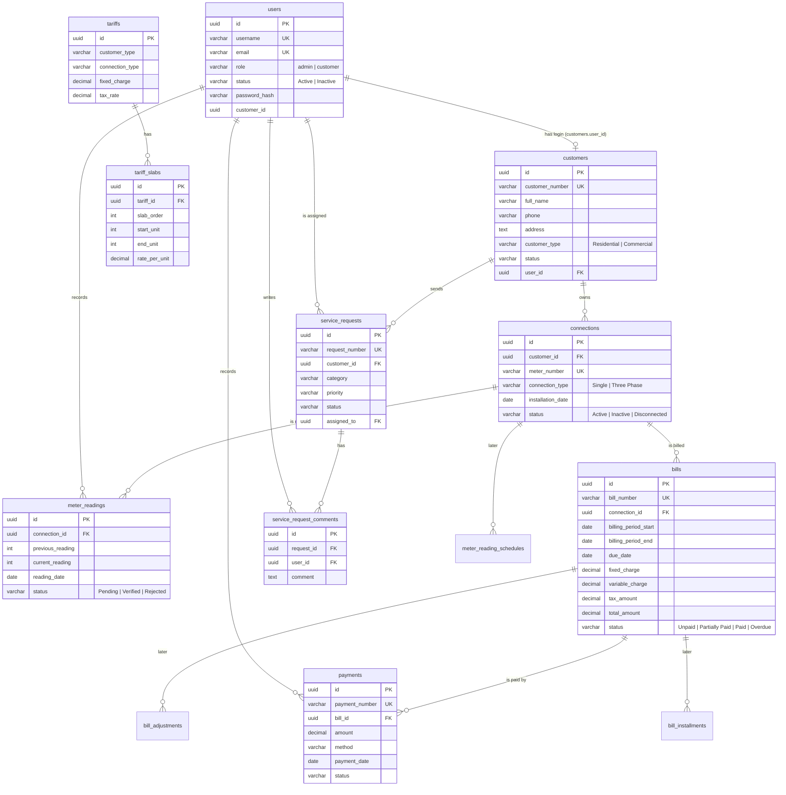

# 2. Database design

PostgreSQL. 13 tables, 2 views, 5 functions, 11 triggers. Primary keys are UUIDs (`uuid_generate_v4()`); people-friendly numbers (CUST-001, MET-0045, BILL-2026-001, PAY-2026-001, REQ-2026-001) are separate UNIQUE columns.

## ER diagram

GitHub and VS Code (with a Markdown preview) draw this diagram automatically. For a picture, pgAdmin can also draw one: right-click the database → **ERD For Database**.

## Tables

| Table | Purpose | Important rules |
| --- | --- | --- |
| `users` | Logins for staff and customers | username + email UNIQUE; role CHECK; one login per customer (`unique_customer_user`) |
| `customers` | Customer profiles | customer_number UNIQUE; type and status CHECK |
| `connections` | Electricity services + meter information | meter_number UNIQUE; deleting a customer deletes their connections (CASCADE) |
| `meter_readings` | Previous / current readings | `current_reading >= previous_reading` (CHECK `valid_reading`) + sequence trigger |
| `bills` | Bills per connection and period | status CHECK; amounts DECIMAL(12,2) |
| `payments` | Money received for a bill | `amount > 0`; method CHECK |
| `service_requests` | Complaints / requests from customers | category, priority, status CHECK |
| `service_request_comments` | Conversation on a request | |
| `tariffs`, `tariff_slabs` | Prices used by the bill calculator | |
| `bill_adjustments`, `bill_installments`, `meter_reading_schedules` | On the "Later" list (no UI yet) | |
| `account_codes` *(new, file 09)* | 8-digit email codes for the **customer login** (every login, like GitHub), **confirming the email** after sign up and **forgot password** | only a SHA-256 hash of the code is stored; `purpose` CHECK; works 15 minutes; 5 wrong tries. A customer with an unused `confirm_email` code cannot log in yet |
| `profile_change_requests` *(new, file 09)* | A customer asks to change their email, phone, customer type or a meter's connection type; an admin approves or rejects | `field` and `status` CHECK; `connection_id` only for `connection_type` (CHECK); **one waiting request per thing** (partial UNIQUE index `change_requests_one_pending`) |
| `sql_file_saves` *(new, file 10)* | One row each time a computer copies the website sign-ups into `database/04_sample_data.sql`: time, computer name, how many customers / logins / meters | the live website reads the newest row to show how many sign-ups are still waiting for the laptop. View `customers_in_order` lists customers by number (a plain `SELECT` has no fixed order) |

## Database logic (the DBMS part)

| Object | Type | What it does |
| --- | --- | --- |
| `update_updated_at_column()` | trigger function | Sets `updated_at = NOW()` on every UPDATE (7 tables) |
| `check_reading_sequence()` | BEFORE trigger on `meter_readings` | A verified reading's `previous_reading` must equal the last verified `current_reading` |
| `update_bill_status()` | AFTER trigger on `payments` | Adds up completed payments and sets the bill to Paid / Partially Paid / Unpaid |
| `check_overdue_bills()` | function | Marks unpaid bills past their due date as Overdue (the API calls it) |
| `calculate_bill_amount(customer_type, connection_type, units)` | function | Reads the tariff + slabs and returns fixed, variable, tax, total |
| `customer_billing_summary` | view | Per customer: bills, billed, paid, outstanding (used by Reports and Customer list) |
| `connection_consumption` | view | Verified readings with consumption per meter |

## How a bill is calculated

1. Find the active tariff for the customer type + connection type (e.g. *Residential Single Phase*: fixed 84, VAT 5 %). Rates are the Bangladesh BERC tariff of June 2026.
2. Walk through the slabs: Residential = first 75 units × 5.26, units 76-200 × 8.50, 201-300 × 9.10, 301-400 × 9.62, 401-600 × 15.01, above 600 × 17.35. Commercial = every unit × 15.36.
3. `tax = (fixed + variable) × 5 %`, `total = fixed + variable + tax`.

Example, 250 kWh residential single phase: 394.50 + 1,062.50 + 455.00 = **1,912.00** → +84 → 1,996.00 → +99.80 VAT → **2,095.80**.

## How "Paid / Unpaid" works

- **Mark paid** inserts one `payments` row for the remaining balance → trigger sets the bill to **Paid**.
- **Mark unpaid** deletes the bill's payments → trigger sets it to **Unpaid** (then `check_overdue_bills()` may make it **Overdue**).

The status is never typed by hand, so it always matches the payments.
