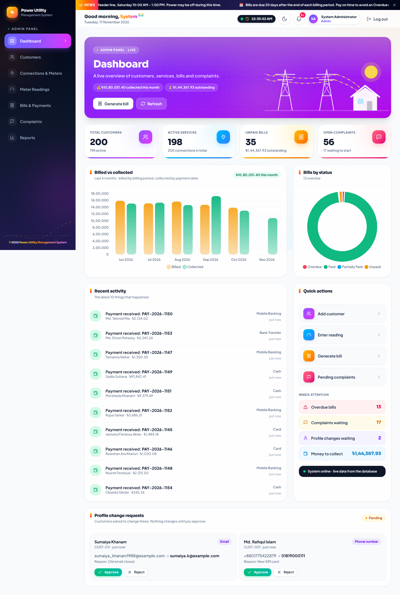
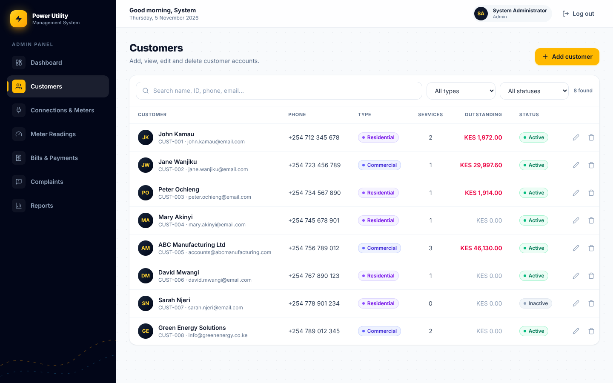
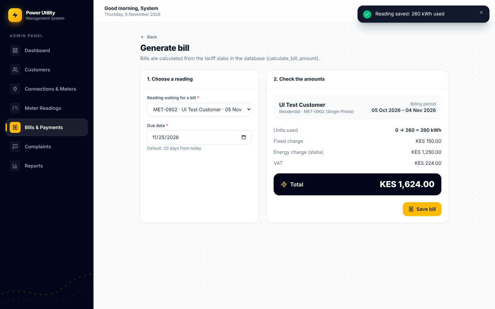
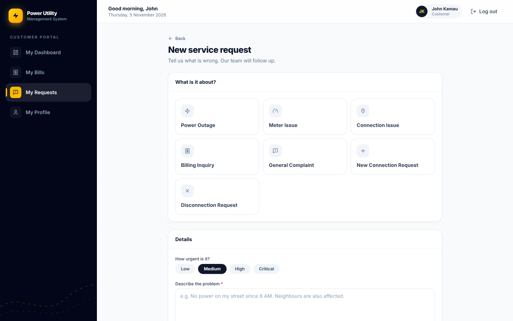

# 5. User guide

How to use each feature. Screenshots are in `docs/images/`.

## Logging in (features 1, 2)

Open http://localhost:5173. The first page has the login card on the right.

1. Pick **Customer** or **Admin** on the slide switch (Role Based Login: an account only works on its own tab).
2. Type your **email or username** and password (demo logins: `PUMSadmin` / `<staff password>` on the Admin tab, `sumaiya.khanam` / `customer123` on the Customer tab). The eye button shows or hides the password.
3. New customers can press **Create an account** (or **Sign up** in the top bar). Sign up is for customers only; admin accounts are made by the system administrator.
   The sign-up form checks everything while you type (a green tick for each rule that is met):
   - **Username:** 3 to 20 characters, only letters, numbers, `.` and `_`, starting and ending with a letter or number, no `..` or `__`, not a system word like `admin` or `support`.
   - **Email:** a real-looking address such as `jane.doe@company.com` (no `..`, no spaces, an ending like `.com`).
   - **Password:** 8 to 64 characters with a capital and a small letter, a number and a symbol (or a passphrase of 3+ words), without your name, username, email or phone, and without easy patterns like `1234` or `qwerty`. Use a password you do not use anywhere else.
   - **Phone number:** pick the country code first (Bangladesh +880 is at the top), then the number. Bangladeshi numbers must be mobile numbers (013 to 019).
   - **Address:** House / road is optional, but **Area** and **City** are both required.
   **Customers: every login has a second step, like GitHub.** After the right password, the card shows **Verify your identity**: a **4-digit code** is emailed to you (subject *[Power Utility] Sudo email verification code*), valid for 15 minutes and usable once. Type it and press **Verify**. No email? Check spam, or press **Send a new code** (once a minute). Admins log in with the password only.
4. After signing up, a **4-digit code** arrives by email. Type it in the box to confirm the email; you are then logged in. No email? Check spam, or press **Send a new code** (once a minute). The code works for 15 minutes.
5. **Forgot password?** (under the password box, Customer tab): type your **email or phone number** → a 4-digit code goes to the email saved on your account → type the code and a new password. Anyone still logged in with the old password is logged out.

Admins land on the **Admin panel**; customers land on the **Customer portal**. Each role only sees its own menu.
The top of the first page shows a **live clock** (today's date and the time). Scroll down for the Vision, the Overview (search box + category buttons), the **Bill estimator**, How it works, the FAQ, **Support** and contact details.

- **Support** (also in the top menu and under Explore at the bottom): anybody can describe a problem and attach one photo or PDF (2 MB). Press **Send my problem**, type the 4-digit code from the email, and the problem goes to the office (`pums.admins@gmail.com` and the admin **Support** page) with a ticket number like SUP-2026-001. When the office solves it, the reply arrives by email.

- **Bill estimator**: pick Residential / Commercial and Single / Three Phase, type the units (or use the slider). The estimate comes from the database bill function, slab by slab.
- **▶ Watch demo** (next to *Explore services* and in *How it works*): a one-minute video tour of the website.
- **Light / dark mode**: press the round **moon** button in the top bar (a **sun** in dark mode) to switch the whole website. The choice is remembered on this computer. Printed bills always stay light.

All money is shown in Bangladeshi Taka, for example **৳2,095.80**; big totals use lakh and crore (৳2.65 lakh).
**Log out** is in the top-right corner.

---

## Admin

### Dashboard (feature 3)

Four live numbers (customers, active services, unpaid bills, open complaints), a **billed vs collected** chart for the last 6 months, bills by status, the **latest 10 activities**, quick-action buttons and **Needs attention** (online payments to confirm, customer readings to check, overdue bills, complaints waiting, money to collect — click one to open the filtered list).

On every page (Admin and Customer):

- The greeting and the dashboard banner follow the clock: morning, afternoon, evening (sunset) and night (moon and stars).
- The **bell** in the top bar: admins see what needs attention (online payments to confirm, readings customers sent, overdue bills, new complaints, profile changes). Customers see their **inbox**: new bills, due reminders, payments confirmed or not received, readings accepted or not, office replies, power notices and profile answers. Unread messages have an orange dot; opening one marks it read, **Mark all as read** clears the count. The browser tab shows the unread count, e.g. *(2) My Bills*.
- The thin **News** strip at the top scrolls announcements. Edit them in `frontend/src/components/layout/announcements.js`. The **X** hides it.

### Customers (features 4, 5, 14)

- **Customers** menu → search by name, ID, phone or e-mail; filter by type and status.
- **Add customer** → fill the form. Tick *Create a login for this customer* to give them portal access.
- Click a row to open the **profile**: contact details, connections (meters), bills and requests.
- ✏️ edits, 🗑️ deletes. A customer **with bills cannot be deleted** (that would erase billing history), so the app offers **Set as Inactive** instead.
- The newest customers are at the top; people who joined in the last 7 days have a green **New** label.
- The green strip above the list says how many customers joined after the 200 sample customers. They are saved live in the database **and** copied into `database/04_sample_data.sql` on the laptop. On the live website an amber strip means some sign-ups are waiting for the laptop to be switched on (they are copied automatically). On the laptop you can also press **Save now**.
- After a customer signs up, the sign-up card shows their new customer number (e.g. *CUST-201*).

### Connections & meters (features 6, 7)

- **Connections & Meters** → list of every service with its meter and last reading.
- **New connection** (or *Add connection* on a customer profile). Leave *Meter number* empty to create one automatically (MET-####).
- Open a connection to see the **meter card** (number, status, odometer of the last reading), meter information, a consumption chart, all readings and bills.
- **Replace meter** (on a connection): type the old meter's final reading, the new meter number (empty = automatic) and its start reading. The old meter's last reading is saved, the history appears under **Meter replacements**, and the next reading starts from the new meter's start reading.

### Meter readings (feature 8)

- **Meter Readings → Enter reading** → choose the meter. The **previous reading is filled in automatically** from the last reading.
- Type the current reading. The live box shows the consumption. The current reading can never be lower than the previous one.
- After saving, click **Generate bill now**.
- The *Waiting for a bill* tab lists readings that have no bill yet.
- A reading far from the meter's usual use shows a warning after saving. **Usage alerts** (button on *Meter Readings*) lists every reading whose use per day is more than double or less than a third of usual. Check them before billing.
- The **Sent by customers** tab lists readings customers typed in themselves (*Pending*). **Verify** makes it count (it can be billed straight away); **Reject** asks for an optional note. Either way the customer gets an inbox message. A Pending reading is never billed.

### Bills (features 9, 10, 11)

- **Bills & Payments → Generate bill** → choose a reading. The amounts are calculated by the database (fixed charge + slab energy charge + VAT) **before** you save.
- The bill list shows amount, due date and status; filter with the status chips or search.
- Every new bill is **emailed** to the customer (if they have an email address). The message after *Generate* says whether the email went out.
- **Mark paid** → choose the method (cash, mobile banking …) → the bill becomes **Paid** (a green tick and confetti confirm it).
  **Mark unpaid** removes the payment again.
- A bill that becomes **Overdue** gets a **5 % late fee** once, automatically. The bill shows it under the total. **Waive late fee** (on the bill, with a reason) cancels it.
- **Paid online:** when a customer uses *Pay now*, the bill shows **Check** and a green box *The customer paid … online* with the method and transaction reference. Check the money arrived, then **Confirm payment** (the bill becomes Paid, the customer gets the receipt) or **Not received** (optional note; the bill stays unpaid). The **Paid online** chip lists every bill waiting for this.
- **Send due reminders** puts a message in the inbox of every customer whose bill is overdue or due in the next 3 days (and emails them). Pressing it again within 3 days does not remind the same bill twice.
- Open a bill to see the printable invoice → **Print** (or *Save as PDF* in the print window). The printed copy keeps the logo and colours.

### Account statement

On a customer profile → **View statement**: every bill, late fee and payment in date order with the balance after each line, like a bank statement. **Print** gives a paper copy.

### Outage notices

**Outage Notices** (menu) → **New notice**: title, area, when the power goes off and comes back. Notices that have not ended yet scroll in the news strip at the top for staff **and** customers. Customers whose address contains the **first place of the area** (e.g. *Mirpur 10* in *Mirpur 10, Dhaka*) also see it on **My Dashboard** and get an inbox message; type **All areas** to tell everyone. The list shows how many customers each notice reaches. Click a notice to edit it.

### Activity log

**Activity Log** (menu): who changed what and when, for customers, meters, readings, bills, payments, requests and notices. Filter by area or action, or search a bill / customer / meter number or a person's name. The database writes it by itself, so nothing is missed.

### Profile change requests

At the bottom of the **Dashboard** (and in *Needs attention* and the bell): customers' requests to change their email, phone, customer type or connection type. Each card shows old → new value and the reason.
**Approve** makes the change at once (an approved email also becomes the customer's login email). **Reject** asks for an optional note for the customer. Either way the customer gets an email.

### Complaints (feature 13)

- **Complaints** → the four coloured cards count Pending / In Progress / Resolved / Cancelled (click one to filter).
- Open a request → change **status**, **priority**, **assigned staff**, write a **resolution note** (required to resolve), and add notes to the conversation.

### Reports (feature 15)

Totals (billed, collected, outstanding, VAT), customers by type, **top customers** (from the `customer_billing_summary` view), billed per month, bills by status, collected per month, payment methods and the latest payments. **Print** gives a paper copy.

---

## Customer

- **My Dashboard**: amount due, overdue bills, open requests, active services, **Alerts** (a bill overdue or due in 3 days, a new bill since your last visit, an office reply, a payment being checked: click one to open it), **Power notices** (outage notices for your area), kWh used per month, latest bill, a **usage gauge** for the latest month (green / amber / red) with a *compared to last month* badge, and **energy-saving tips**.
- **Meter & Usage**: type the number on your meter (**Send reading**). It waits as *Pending* until the office checks it. You see **this month so far** (kWh since the last official reading), how much a full month will be at this pace and the **bill it is heading for**, plus a warning before the price per kWh goes up (home tariffs have price bands). Below: your last readings and a **bill calculator** with **Count my appliances** (fans, lights, fridge, AC … × hours a day → kWh a month). The calculator and the appliance helper are also on the first page, no login needed.
- **My Bills**: every bill with its payment status; open one for the full printable bill. A late bill shows its 5 % late fee. **Pay now** (demo): choose *Mobile Banking* or *Card*, pay, then type the **transaction reference** from your payment message. You never type a card number or PIN. The full balance is paid; the bill says *Your payment is being checked* until the office confirms it.
- **My Payments**: every payment (being checked, completed, not received) with totals. **Receipt** opens a printable receipt with a *PAID* stamp (*Print / Save as PDF*).
- **My Statement**: all your bills and payments in date order with the balance after each one.
- **My Requests → New request**: choose what it is about, how urgent, describe it. Follow the progress bar (Pending → In Progress → Resolved) and staff replies. While it is open you can **reply** to the office at the bottom of *Updates*.
- **My Profile**: contact details and meters (the meter numbers roll up like a real meter).
- **Give Feedback** (also at the bottom of the first page, no login needed): choose 1-5 stars and a topic, write what you think. Each message is emailed to the team.
  - **Edit my details**: change your **name and address** straight away.
  - **Request a change**: a new **email, phone number, customer type** or a meter's **connection type** needs the office's OK. The request appears under **My change requests** as *Pending*, then *Approved* or *Rejected* (with the office's note). You also get an email with the answer.

