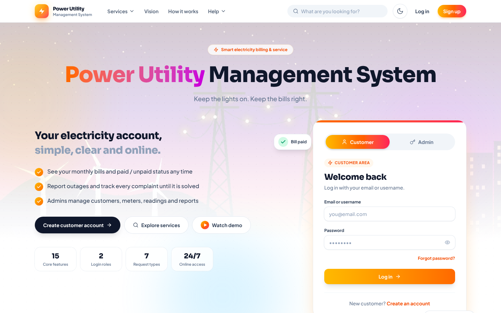
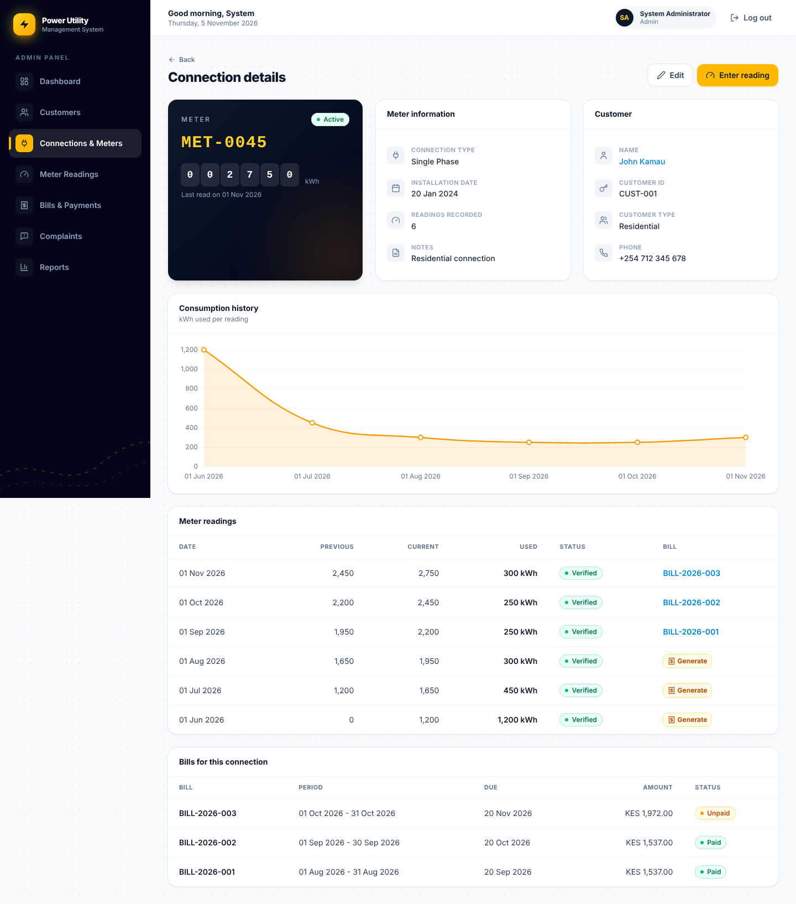
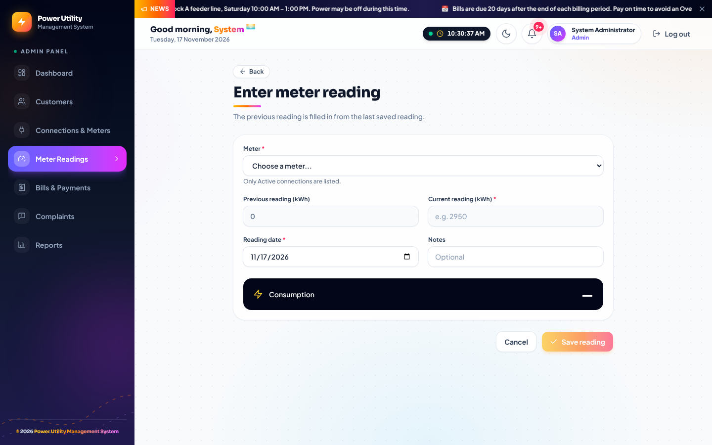
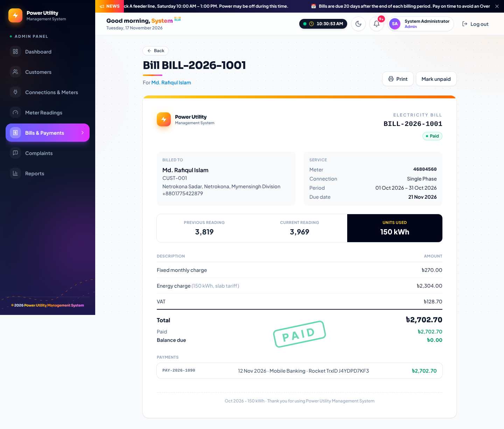
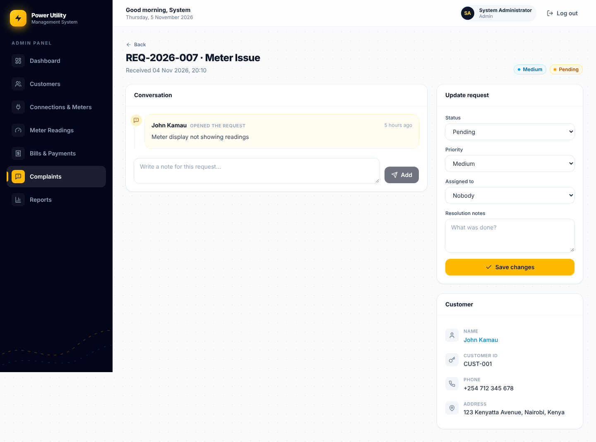
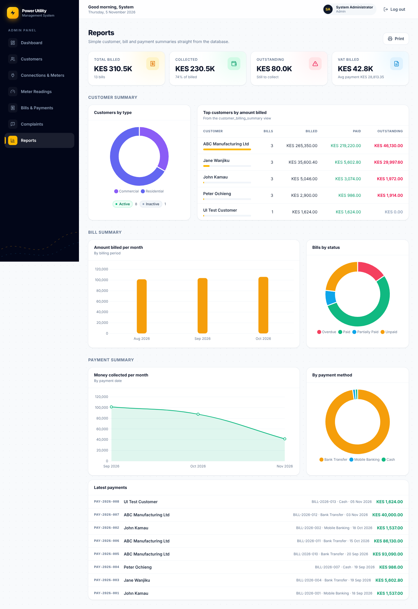
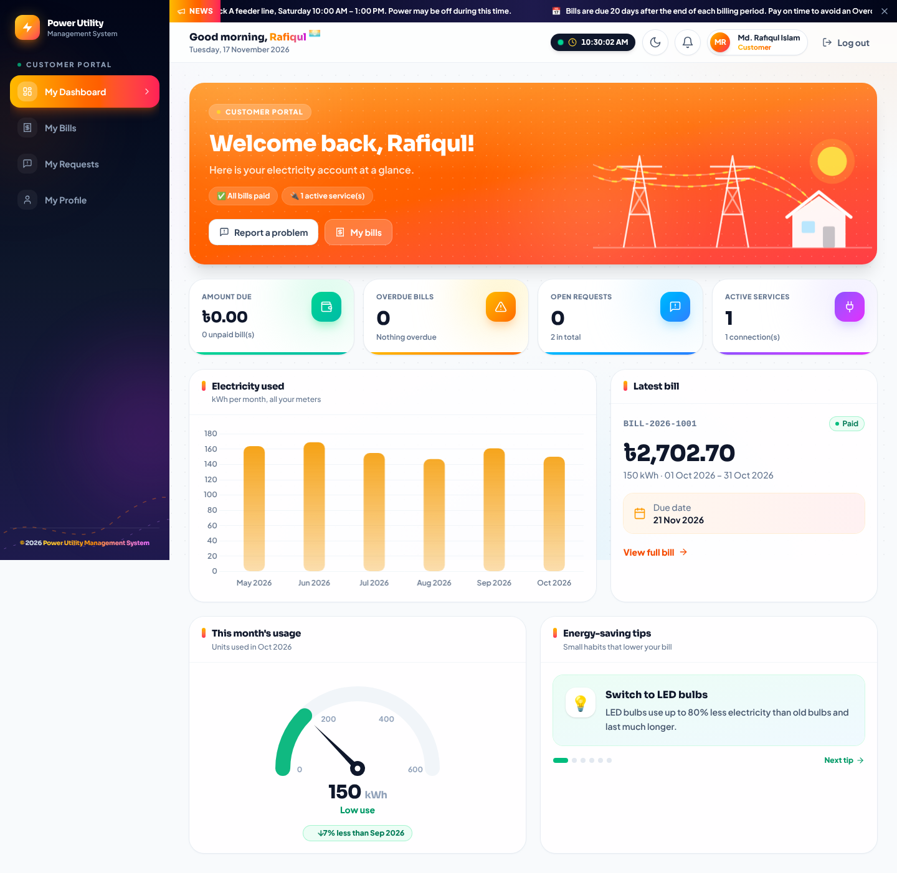

# 5. User guide

How to use each feature. Screenshots are in `docs/images/`.

## Logging in (features 1, 2)

Open http://localhost:5173. The first page has the login card on the right.

1. Pick **Customer** or **Admin** on the slide switch (Role Based Login: an account only works on its own tab).
2. Type your **email or username** and password (demo logins: `PUMSadmin` / `PUMS@dmin578` on the Admin tab, `sumaiya.khanam` / `customer123` on the Customer tab). The eye button shows or hides the password.
3. New customers can press **Create an account** (or **Sign up** in the top bar). Sign up is for customers only; admin accounts are made by the system administrator.
   The password needs **8+ characters with a letter and a number** (both password boxes have an eye button).
   **Customers: every login has a second step, like GitHub.** After the right password, the card shows **Verify your identity**: an **8-digit code** is emailed to you (subject *[Power Utility] Sudo email verification code*), valid for 15 minutes and usable once. Type it and press **Verify**. No email? Check spam, or press **Send a new code** (once a minute). Admins log in with the password only.
4. After signing up, an **8-digit code** arrives by email. Type it in the box to confirm the email; you are then logged in. No email? Check spam, or press **Send a new code** (once a minute). The code works for 15 minutes.
5. **Forgot password?** (under the password box, Customer tab): type your **email or phone number** → an 8-digit code goes to the email saved on your account → type the code and a new password. Anyone still logged in with the old password is logged out.

Admins land on the **Admin panel**; customers land on the **Customer portal**. Each role only sees its own menu.
Scroll down the first page for the Vision, the Overview (search box + category buttons), the **Bill estimator**, How it works, the FAQ and contact details.

- **Bill estimator**: pick Residential / Commercial and Single / Three Phase, type the units (or use the slider). The estimate comes from the database bill function, slab by slab.
- **▶ Watch demo** (next to *Explore services* and in *How it works*): a one-minute video tour of the website.
- **Light / dark mode**: press the round **moon** button in the top bar (a **sun** in dark mode) to switch the whole website. The choice is remembered on this computer. Printed bills always stay light.

All money is shown in Bangladeshi Taka, for example **৳2,095.80**; big totals use lakh and crore (৳2.65 lakh).
**Log out** is in the top-right corner.

---

## Admin

### Dashboard (feature 3)

Four live numbers (customers, active services, unpaid bills, open complaints), a **billed vs collected** chart for the last 6 months, bills by status, the **latest 10 activities**, quick-action buttons and **Needs attention** (overdue bills, complaints waiting, money to collect — click one to open the filtered list).

On every page (Admin and Customer):

- The greeting and the dashboard banner follow the clock: morning, afternoon, evening (sunset) and night (moon and stars).
- The **bell** in the top bar lists what needs attention (admins: overdue bills and new complaints; customers: bills to pay and open requests).
- The thin **News** strip at the top scrolls announcements. Edit them in `frontend/src/components/layout/announcements.js`. The **X** hides it.

### Customers (features 4, 5, 14)

- **Customers** menu → search by name, ID, phone or e-mail; filter by type and status.
- **Add customer** → fill the form. Tick *Create a login for this customer* to give them portal access.
- Click a row to open the **profile**: contact details, connections (meters), bills and requests.
- ✏️ edits, 🗑️ deletes. A customer **with bills cannot be deleted** (that would erase billing history), so the app offers **Set as Inactive** instead.
- The newest customers are at the top; people who joined in the last 7 days have a green **New** label.
- The green strip above the list says how many customers joined after the 200 sample customers. They are saved live in the database **and** copied into `database/04_sample_data.sql`. If it turns amber, press **Save now**.
- After a customer signs up, the sign-up card shows their new customer number (e.g. *CUST-201*).

### Connections & meters (features 6, 7)

- **Connections & Meters** → list of every service with its meter and last reading.
- **New connection** (or *Add connection* on a customer profile). Leave *Meter number* empty to create one automatically (MET-####).
- Open a connection to see the **meter card** (number, status, odometer of the last reading), meter information, a consumption chart, all readings and bills.

### Meter readings (feature 8)

- **Meter Readings → Enter reading** → choose the meter. The **previous reading is filled in automatically** from the last reading.
- Type the current reading. The live box shows the consumption. The current reading can never be lower than the previous one.
- After saving, click **Generate bill now**.
- The *Waiting for a bill* tab lists readings that have no bill yet.

### Bills (features 9, 10, 11)

- **Bills & Payments → Generate bill** → choose a reading. The amounts are calculated by the database (fixed charge + slab energy charge + VAT) **before** you save.
- The bill list shows amount, due date and status; filter with the status chips or search.
- Every new bill is **emailed** to the customer (if they have an email address). The message after *Generate* says whether the email went out.
- **Mark paid** → choose the method (cash, mobile banking …) → the bill becomes **Paid** (a green tick and confetti confirm it).
  **Mark unpaid** removes the payment again.
- Open a bill to see the printable invoice → **Print** (or *Save as PDF* in the print window). The printed copy keeps the logo and colours.

### Profile change requests

At the bottom of the **Dashboard** (and in *Needs attention* and the bell): customers' requests to change their email, phone, customer type or connection type. Each card shows old → new value and the reason.
**Approve** makes the change at once (an approved email also becomes the customer's login email). **Reject** asks for an optional note for the customer. Either way the customer gets an email.

### Complaints (feature 13)

- **Complaints** → the four coloured cards count Pending / In Progress / Resolved / Cancelled (click one to filter).
- Open a request → change **status**, **priority**, **assigned staff**, write a **resolution note** (required to resolve), and add notes to the conversation.

### Reports (feature 15)

Totals (billed, collected, outstanding, VAT), customers by type, **top customers** (from the `customer_billing_summary` view), billed per month, bills by status, collected per month, payment methods and the latest payments. **Print** gives a paper copy.

---

## Customer

- **My Dashboard**: amount due, overdue bills, open requests, active services, kWh used per month, latest bill, a **usage gauge** for the latest month (green / amber / red) with a *compared to last month* badge, and **energy-saving tips**.
- **My Bills**: every bill with its payment status; open one for the full printable bill. The browser tab shows how many bills are still unpaid, e.g. *(1) My Bills*.
- **My Requests → New request**: choose what it is about, how urgent, describe it. Follow the progress bar (Pending → In Progress → Resolved) and staff replies.
- **My Profile**: contact details and meters (the meter numbers roll up like a real meter).
  - **Edit my details**: change your **name and address** straight away.
  - **Request a change**: a new **email, phone number, customer type** or a meter's **connection type** needs the office's OK. The request appears under **My change requests** as *Pending*, then *Approved* or *Rejected* (with the office's note). You also get an email with the answer.

